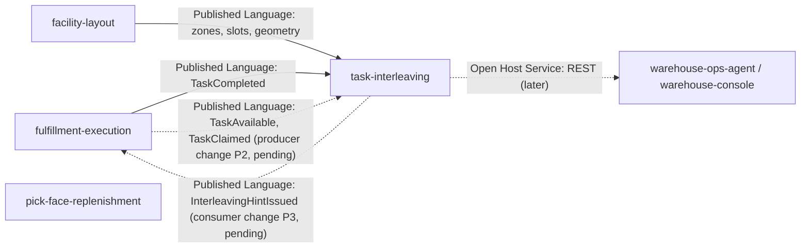

# ADR 0001: task-interleaving as the advisor of next-task hints at a station

## Status

Accepted (2026-10-17).

## Context

When an operator finishes a task, `fulfillment-execution` hands the next one out
through its pull-based `claimNext(stationId, capabilities)`: the system selects
work, the worker never picks it, and a lease protects a claim
(fulfillment-execution ADR 0002 and ADR 0003). Nothing in the fleet asks "which
open task is **close to where this operator now stands**?". A picker who ends at
aisle A01 can be sent to aisle A19 while a task two bins away waits, so travel
time, the largest share of pick labour, is spent without a policy. Task
interleaving (also called task chaining or dual command cycling) is the standard
WES answer: weigh the travel from the end of one task to the start of the next.

The central tension, stated plainly: **interleaving could be a policy inside
fulfillment-execution's `claimNext`.** That context already owns the task pool,
the claim and the priority order, so the simplest design is one more ordering
rule there, and a purist would say a separate context only adds a network hop.
This context exists as a separate context by the user's directive, and that
directive is only sound because of how it is shaped:

- It is **advisory**. It publishes a hint (a short ranked list of candidate
  tasks); fulfillment-execution stores it in a local table and uses it only as a
  tie-break **inside one priority band**, never across a CPT or priority
  boundary, fail-open when the hint is absent, expired or unknown.
- It never issues an `assign`. `claimNext` stays the only claim path and the
  lease semantics are untouched. A hint that is ignored costs nothing.
- It owns no task state. It keeps event-fed copies of the open-task pool, of
  claims and of location geometry; fulfillment-execution stays the single writer
  of the task lifecycle.

If any of these three properties is dropped (a hint becoming a command, a
cross-band override, or this context writing task state), the separation stops
paying for itself and the logic belongs back inside fulfillment-execution. That
is the test a future reviewer should apply. Alternatives weighed and rejected:
(a) a rule inside `claimNext` (couples a replaceable policy to the Core task
lifecycle and its claim path; this is the fallback, not a mistake); (b) a
synchronous `GET` from fulfillment-execution to this context on every claim
(puts a live cross-context call on the hot claim path, forbidden by the fleet
rule); (c) putting the recommender in `warehouse-planning` (a capacity planner,
not a dispatcher).

## Decision

Introduce `task-interleaving` as a new bounded context in the WES subdomain. It
owns the **StationTrip** (one per station: where the operator stands and the
hint issued there) and the **InterleavingPolicy** (per site: how far, how many,
for how long, for which task types), and the pure recommender between them.

### Bounded context canvas

| Field | Value |
|---|---|
| Name | task-interleaving |
| Purpose | After a station completes a task, recommend the few open tasks nearest to where the operator now stands, as an advisory, expiring hint that fulfillment-execution may use as a tie-break. |
| Strategic classification | **Supporting subdomain**. Detour limits and ranking are replaceable policy objects (`TravelModel`, the recommender) and do not differentiate the platform; the conductor (`wes-work-planning`) and the task lifecycle (`fulfillment-execution`) stay Core. |
| Tier / CloudEvents subdomain | **WES** ("how work is executed"), subdomain `wes`. Type prefix `com.warehouse.wes.task-interleaving.`, source `/warehouse/task-interleaving`, Kong path `/api/task-interleaving`. |
| Domain roles | Advisor (computes hints), policy holder (per-site settings), simulation (read-only what-if). |
| Inbound communication | Events from `fulfillment-execution` (`TaskAvailable`, `TaskClaimed`, `TaskCompleted`) and `facility-layout` (zones, slots, geometry) (ADR 0003); REST commands from operators (`PUT /sites/{siteId}/policy`) and read-only queries. |
| Outbound communication | `InterleavingHintIssued` on `warehouse.task-interleaving.events`; hint outcomes and policy declarations on the analytics topic only (ADR 0004); REST reads for operators, the console and agents. |
| Ubiquitous language | StationTrip, position, hint (Active, Consumed, Expired, Superseded), candidate, detour, policy, travel model, open-task pool, priority band, tie-break. |
| Business decisions | Max detour; max candidates (1 to 5); hint time-to-live; eligible task types; weight of vertical travel (ADR 0002). |
| Assumptions | A station's position is the end location of its last completed task; a location's site is its zone's site; geometry from facility-layout is in metres in one frame per site; the pool copy is as fresh as the events (ADR 0003). |
| Verification | Deterministic recommender (same pool in any order, same output); mutation gate over the four domain packages; golden tests per published type. |

### The model (v1)

Two aggregates and a pure recommender; the invariants are ADR 0002.

### Context map

| Edge | Relationship | Status |
|---|---|---|
| facility-layout -> task-interleaving | Open Host Service / Published Language (`ZoneRegistered`, `LocationSlotRegistered`, `LocationSlotDecommissioned`, `LocationGeometryUpdated`, `warehouse.facility.events`); task-interleaving is a **Conformist** and keeps a local location copy | Contract verified on `origin/develop` 2026-10-17 (geometry: facility-layout ADR 0017); consumer in wave 2 |
| fulfillment-execution -> task-interleaving, `TaskCompleted` | Published Language (`warehouse.fulfillment.events`); **Conformist** | Contract verified on `origin/develop` 2026-10-17; consumer in wave 2 |
| fulfillment-execution -> task-interleaving, `TaskAvailable` and `TaskClaimed` | Published Language; **Conformist** | **PLANNED**: producer change P2 (consumer-first: this context ships first and accepts them) |
| task-interleaving -> fulfillment-execution | Published Language (`InterleavingHintIssued`); fulfillment-execution is a **Conformist** to the payload but owns the decision to use it (tie-break inside one priority band, fail-open) | **PLANNED**: consumer change P3 in fulfillment-execution |
| task-interleaving -> warehouse-ops-agent, warehouse-console | **Open Host Service** (REST) | **PLANNED**: later waves |

### Exclusions

- **No `assign`, no claim path, no task state.** This context never tells a
  worker or a station what to do and never writes the task lifecycle.
- **No edge to `wes-work-planning`, `process-path-management`,
  `order-management`, `inventory-storage`, `labor-performance`.** Priority bands
  and CPT stay opaque to this context: `priority_band` is carried and never
  interpreted.
- **No edge to `pick-face-replenishment`.** `REPLENISH` tasks reach this context
  only as ordinary `TaskAvailable` occurrences, like any other task type.
- **No per-worker data.** Hints are per station; the associate is not an input.
- Out of scope for v1 (later ADRs): aisle and cross-aisle routing (a later
  `TravelModel`), multi-stop batching, learned or ML ranking, cross-station
  balancing, hints on the station UI itself.

### No live cross-context lookup, in either direction

- task-interleaving never calls a sibling context at request time: no outbound
  HTTP client, no MCP client.
- No sibling calls task-interleaving on its hot path. fulfillment-execution reads
  `warehouse.task-interleaving.events`; the REST endpoints exist for operators,
  the console and agents.

## Consequences

- A new deployable (API, Postgres database, Kafka topics, Kong route
  `/api/task-interleaving`) joins the fleet; `warehouse-infra` wires it by hand
  in the wiring wave.
- The fleet CloudEvents documentation already names `wes` as a subdomain, so no
  new subdomain row is needed.
- The pool copy is the weak spot: a stale or empty pool yields stale or no
  hints, never wrong assignments, because the hint is advisory and expires.
- Until producer change P2 lands, the open-task pool stays empty in a real
  cluster and no hint can be issued. This is deliberate (consumer-first) and
  visible: a site is also inert until its policy is declared.
- Nothing changes on the floor until fulfillment-execution's consumer change P3
  exists; until then hints are published and observable only.
