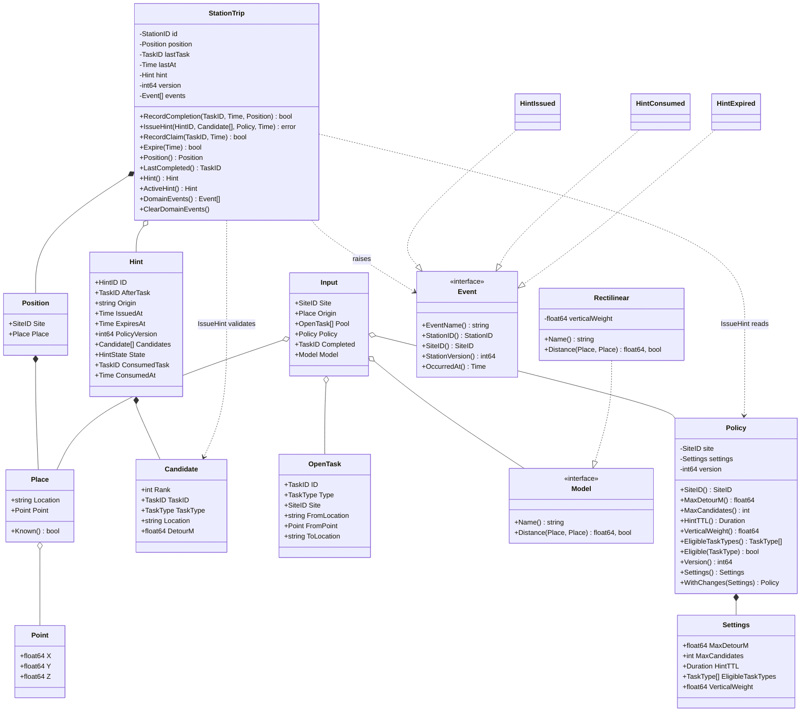
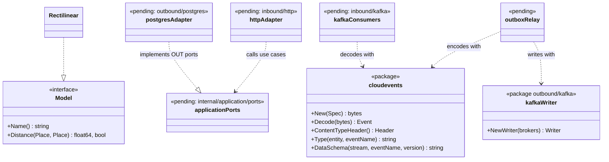

# Class diagrams

UML class diagrams of the domain as it is in `internal/domain`, and of the
hexagonal ports with the adapters that exist. Types are Go types; "interface" marks
a Go interface.

## Domain types

Source: `internal/domain/policy/policy.go`, `internal/domain/travel/travel.go`,
`internal/domain/recommend/recommend.go`, `internal/domain/stationtrip/{trip,values,events}.go`.
Omits: the value types `SiteID`, `StationID`, `HintID`, `TaskID`, `TaskType`,
`HintState`, the `Header` embedded in every event, the error variables and the
functions `recommend.Recommend` and `recommend.RectilinearFor` (they have no
receiver). `Policy.Settings()` is both a field and an accessor in the code; the
diagram shows the accessor.

Hint states: `StateActive`, `StateConsumed`, `StateExpired`, `StateSuperseded`
(`HintState`, with `Valid()` and `Terminal()`).

## Ports and adapters

Source: `internal/domain/travel/travel.go` (the only port declared in the domain),
`internal/adapters/kafka/cloudevents/cloudevents.go`,
`internal/adapters/outbound/kafka/writer.go`, `internal/architecture/architecture_test.go`
(the layer rules). Boxes tagged *pending* have no code on `develop`; their
relationships are the layout fixed by ADR 0001 and ADR 0004, not observed imports.
