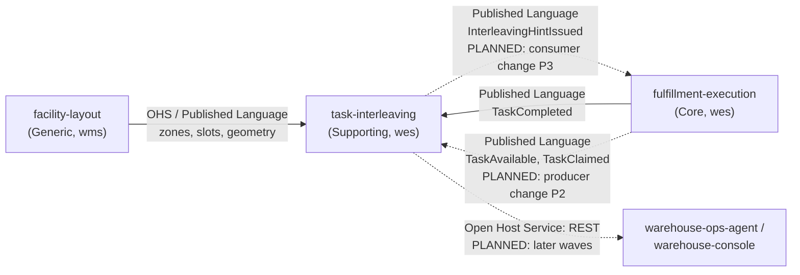

# Context map

This context's slice of the fleet map, following
[Context Mapping](https://github.com/ddd-crew/context-mapping). Relationship
patterns come from [ADR 0001](/docs/adr/0001-task-interleaving-bounded-context);
the **Status** column separates what the producers publish today from what is
planned. The fleet-wide map lives in warehouse-docs.

Source: `docs/adr/0001-task-interleaving-bounded-context.md` (context map and edge
table), `docs/adr/0003-local-copies-and-consumed-contracts.md`, `apis/asyncapi.yaml`.
Solid arrows are contracts the producer publishes today; dotted arrows are planned
on at least one side. Omits the contexts this one deliberately has no edge to.

## Edges

| Edge | Relationship | Status |
| --- | --- | --- |
| facility-layout -> task-interleaving | Open Host Service / Published Language (`ZoneRegistered`, `LocationSlotRegistered`, `LocationSlotDecommissioned`, `LocationGeometryUpdated` on `warehouse.facility.events`); task-interleaving is a **Conformist** and keeps a local location copy | Producer contract present in `facility-layout`'s `apis/asyncapi.yaml` on `origin/develop`; consumer designed, not built |
| fulfillment-execution -> task-interleaving, `TaskCompleted` | Published Language (`warehouse.fulfillment.events`); **Conformist** | Producer contract present on `origin/develop`; consumer designed, not built |
| fulfillment-execution -> task-interleaving, `TaskAvailable` and `TaskClaimed` | Published Language; **Conformist** | **PLANNED**: producer change P2 (consumer-first: this context ships first and accepts them). `TaskClaimed` exists today only as an analytics occurrence. |
| task-interleaving -> fulfillment-execution | Published Language (`InterleavingHintIssued`); fulfillment-execution is a **Conformist** to the payload but owns the decision to use it (tie-break inside one priority band, fail-open) | **PLANNED**: consumer change P3 in fulfillment-execution |
| task-interleaving -> warehouse-ops-agent, warehouse-console | **Open Host Service** (REST) | **PLANNED**: later waves; REST contract written, no server |

## Deliberate non-edges

ADR 0001's *Exclusions*: no edge to `wes-work-planning`, `process-path-management`,
`order-management`, `inventory-storage` or `labor-performance` (priority bands and
CPT stay opaque; `priority_band` is carried and never interpreted); no edge to
`pick-face-replenishment` (`REPLENISH` tasks arrive as ordinary `TaskAvailable`
occurrences); and no live cross-context lookup in either direction: no outbound
HTTP client, no MCP client, and no sibling calls this context on its hot path.

## Why a separate context at all

The ADR's own answer is the test a reviewer should apply: interleaving **could** be
a rule inside `claimNext`, and it stays a separate context only while the hint is
advisory, never issues an `assign` and owns no task state. If any of those three
properties is dropped, the logic belongs back in fulfillment-execution. See the
[Core domain chart](/docs/ddd/core-domain-chart).
