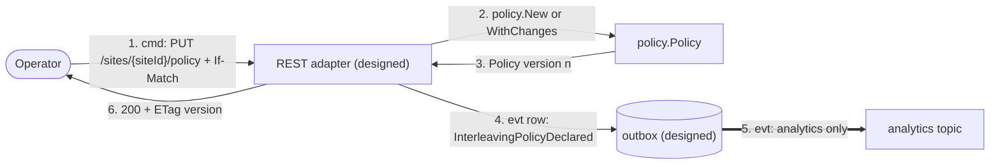
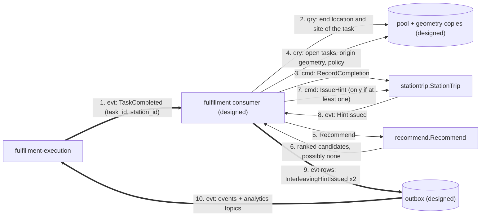
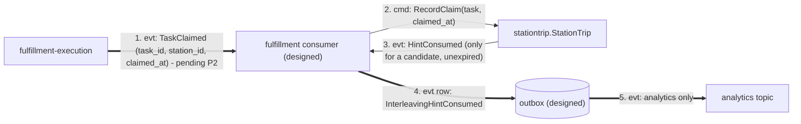
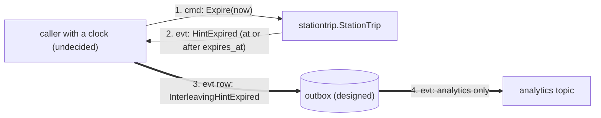
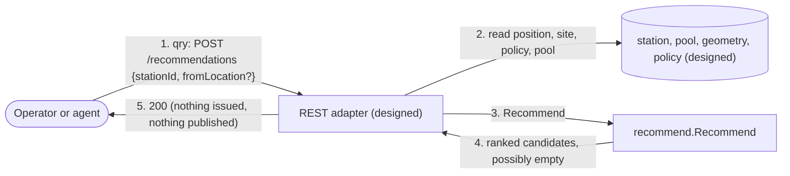

# Domain message flow

[Domain Message Flow Modelling](https://github.com/ddd-crew/domain-message-flow-modelling)
of the key scenarios: commands, events and queries as numbered messages between
collaborators. The domain steps (`policy`, `recommend`, `stationtrip`) exist as
code; the collaborators that carry the messages (REST handlers, consumers, outbox
relay) are **designed, not built**, and fulfillment-execution's side of flows 2 to 4
is partly pending (producer change P2, consumer change P3).

## Flow 1 — declare a policy

Source: `internal/domain/policy/policy.go`, `apis/openapi.yaml`
(`declareInterleavingPolicy`), `apis/asyncapi.yaml`. Failure branches: invalid
settings 400 `invalid-policy` or `invalid-task-type`; stale or missing `If-Match`
on an existing policy 412 `version-mismatch`; lost race 409 `concurrent-modification`.

## Flow 2 — a station completes a task, a hint is issued

Source: `internal/domain/stationtrip/trip.go`, `internal/domain/recommend/recommend.go`,
ADR 0002, ADR 0003, ADR 0004. Branches:

- No candidate: step 7 does not happen; an older Active hint is **not** retracted
  and expires at its TTL.
- Origin without geometry: `ErrOriginUnknown`, no hint.
- A completion for a task the pool never saw: counted and skipped, not
  dead-lettered.
- A site with no policy: inert, no hint.
- The hint is advisory: fulfillment-execution may use it as a tie-break inside one
  priority band (consumer change P3, pending).

## Flow 3 — the hinted station claims a candidate

Source: `StationTrip.RecordClaim`, ADR 0003. A claim of a non-candidate, a claim after
expiry or a claim with no Active hint changes nothing and publishes nothing.

## Flow 4 — a hint expires

Source: `StationTrip.Expire`, `apis/openapi.yaml` ("the clock marks it Expired").
No ADR or contract names the component that calls `Expire`.

## Flow 5 — simulate a recommendation (query)

Source: `apis/openapi.yaml` (`recommendTasks`), `recommend.Recommend`. Branches:
`422 policy-not-declared`, `422 origin-unknown`, `422 station-position-unknown`
(no `fromLocation` and no recorded position), `400 idempotency-key-required` and
`422 idempotency-key-reused` where the Idempotency-Key is enforced.
