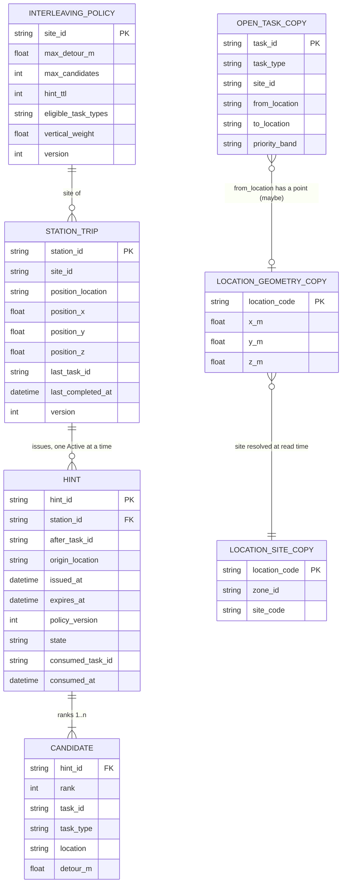

# Entity-relationship diagram

:::caution No database schema on develop
`develop` has no migration and no Postgres adapter, so there is **no table** to
draw. The diagram below is the **conceptual** model of the domain as the Go types
and the ADRs define it: entities, value objects and the event-fed read models,
with their keys and relationships. Entity names are domain names, not table names.
Do not infer a schema from it; the real tables belong to the service branch.
:::

Source: `internal/domain/policy/policy.go` (`Settings`), `internal/domain/stationtrip/{trip,values}.go`
(`StationTrip`, `Position`, `Hint`), `internal/domain/recommend/recommend.go`
(`Candidate`, `OpenTask`), `docs/adr/0002-stationtrip-and-policy-aggregates.md`,
`docs/adr/0003-local-copies-and-consumed-contracts.md`. Omits: the claims copy, the
idempotency records, the transactional outbox and every storage detail (ADR 0003 and
ADR 0004 name them; no code does).

## Reading it

| Entity | Kind | Notes |
| --- | --- | --- |
| `INTERLEAVING_POLICY` | aggregate root | Id = site id. Immutable value per version; a change produces version + 1. A site with no row is inert. |
| `STATION_TRIP` | aggregate root | Id = station id. Holds the position of the end of the last completed task and the hint. |
| `HINT` | entity inside `STATION_TRIP` | In code only the most recent hint is held (`StationTrip.hint`); the REST contract (`GET /hints`) lists past hints, so persistence is expected to keep them. At most one is `Active`. |
| `CANDIDATE` | value object of a hint | 1 to `MaxCandidates` entries, distinct task ids, ranks 1..n. |
| `OPEN_TASK_COPY` | event-fed read model | Keyed by task id (ADR 0003). Input of the recommender, not aggregate state. `priority_band` is carried and never interpreted. |
| `LOCATION_GEOMETRY_COPY`, `LOCATION_SITE_COPY` | event-fed read models | A location's site is found at read time through its zone, so zone, slot and geometry may arrive in any order. A location with no geometry has an unknown distance. |

The link `INTERLEAVING_POLICY` to `STATION_TRIP` is by site: `IssueHint` refuses a
policy whose site is not the station's site (`ErrSiteMismatch`). The link between
a trip and a policy is not a foreign key in the domain; the use case supplies the
policy.
