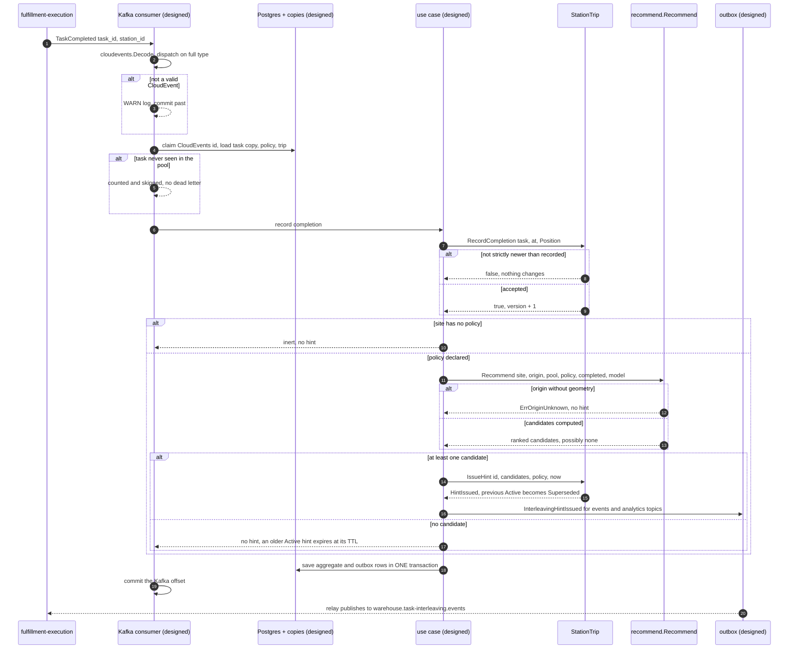
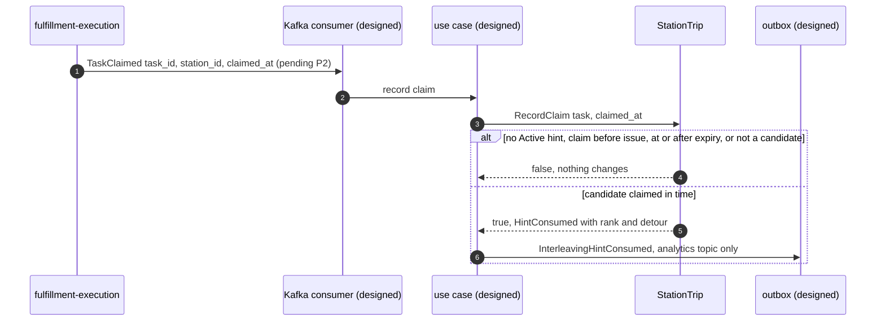
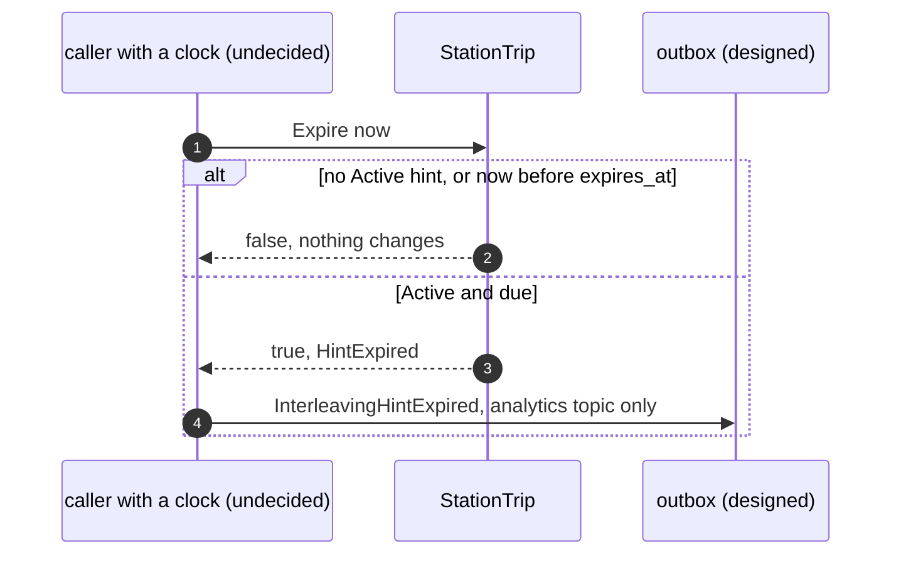
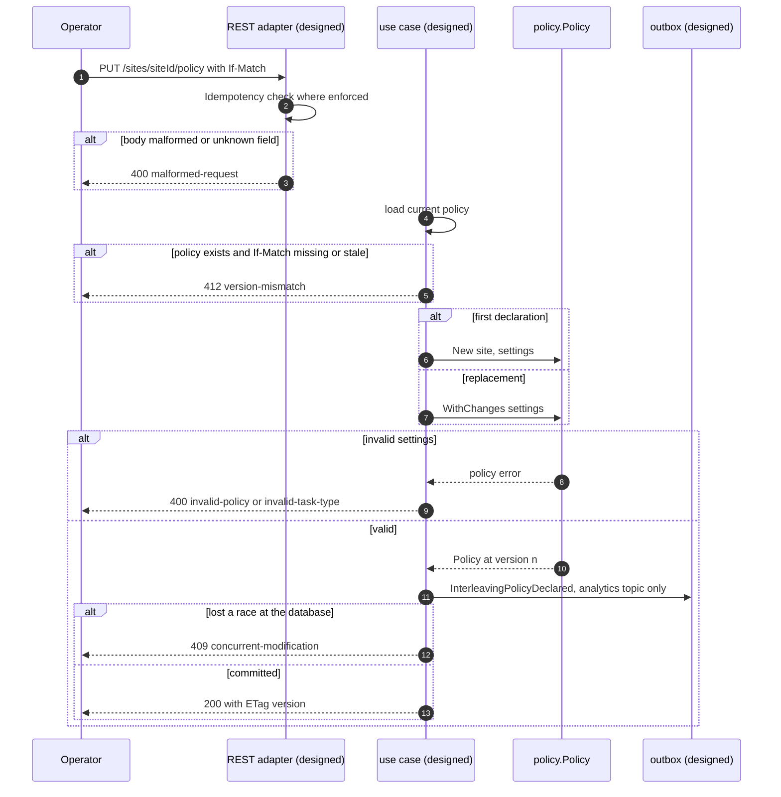
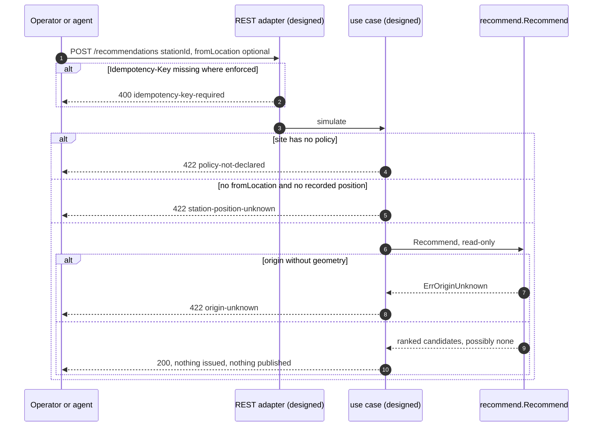

# Sequence diagrams

UML sequence diagrams of the key scenarios, with error branches. The domain calls
are real (`internal/domain`); the participants labelled *designed* (consumers, use
cases, repositories, outbox, REST adapter) are not on `develop`. Where a message
names a Go function it is a function that exists.

## Complete a task, issue a hint

Source: `StationTrip.RecordCompletion`, `StationTrip.IssueHint`, `recommend.Recommend`,
`cloudevents.Decode`, ADR 0002, ADR 0003, ADR 0004.

## The hinted station claims a candidate

Source: `StationTrip.RecordClaim`, `apis/asyncapi.yaml` (`TaskClaimed`).

## A hint expires

Source: `StationTrip.Expire`. The caller is not named by any ADR or contract.

## Declare a policy

Source: `policy.New`, `Policy.WithChanges`, `apis/openapi.yaml`
(`declareInterleavingPolicy`). Step order inside the designed use case is inferred
from the contract; only the `policy` calls exist.

## Simulate a recommendation

Source: `recommend.Recommend`, `apis/openapi.yaml` (`recommendTasks`).
