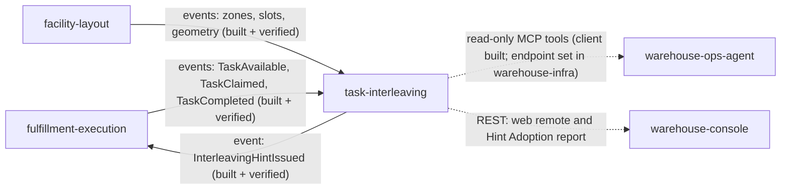

# Integration

How `task-interleaving` fits with the rest of the fleet, with the **status of
every edge**. Three words are used strictly:

- **Built**: code on this repo's `origin/develop` that does the job.
- **Verified**: the other side was read on its own `origin/develop`
  (`fulfillment-execution` at `453212b`, which includes its PR #221 (ADR 0050),
  `facility-layout` at `4518c60`, fetched 2026-10-17) and matches. The edges to
  `fulfillment-execution` (the hint consumer), `warehouse-infra` and
  `warehouse-console` were re-read on 2026-11-09 (`fulfillment-execution` at
  `0718769`, `warehouse-infra` at `02bf9b7`, `warehouse-console` at `298ec71`).
- **Absent**: no code on either side.

Both consumers are built and verified against their producers and are **always
on**: the service refuses to boot without `KAFKA_BROKERS` and the two consumer
group ids ([ADR 0006](/docs/adr/0006-postgres-and-kafka-are-the-only-runtime)).
`warehouse-infra` registers this service (see
[Infrastructure wiring](#infrastructure-wiring)). The cluster broker auto-creates every business topic
on first write and infrastructure declares none, so the four topics it needs
need no infrastructure entry ([ADR 0006 Amendment 1](/docs/adr/0006-postgres-and-kafka-are-the-only-runtime)).

## Edge map

Source: `internal/adapters/inbound/kafka/fulfillment_consumer.go`,
`internal/adapters/inbound/kafka/layout_consumer.go`,
`internal/adapters/outbound/events/encoder.go`, `apis/asyncapi.yaml`, and the
producers' `apis/asyncapi.yaml` on their `origin/develop`. Solid edges have code
on both sides. Dotted edges have code on one side only.

## Upstream (task-interleaving consumes)

| Producer | Protocol | Topic | Contract (full `type`) | Status |
| --- | --- | --- | --- | --- |
| fulfillment-execution | Kafka, CloudEvents 1.0 | `warehouse.fulfillment.events` | `com.warehouse.wes.fulfillment-execution.task.TaskCompleted`: reads `task_id`, `station_id` | **Built + verified.** Present in the producer's `apis/asyncapi.yaml`; `station_id` is a required field of its payload. |
| fulfillment-execution | same | same | `...task.TaskAvailable`: reads `task_id, task_type, site_id, from_location, to_location, required_capabilities[], priority_band` (ignores `cpt`, `available_at`) | **Built + verified.** The producer publishes it since its ADR 0049 (commit `257a567`), for REPLENISH tasks too since its ADR 0050 (PR #221) and for PICK tasks since its ADR 0062 (PR #279, on its `origin/develop`). **Announced types: RELOCATE, REPLENISH and PICK.** A REPLENISH task is announced with `from_location` = the source (reserve) bin and `to_location` = the destination (pick face) bin (its ADR 0050, section 6). A PICK is announced only when its plan carries both the site (`WorkReleased.data.pick.site_id`) and the pick face (`from_bin`); the pick face is then both `from_location` and `to_location`, and a PICK missing either is not announced. A PACK, SLAM, REBIN or transfer task has no location in the producer and is not announced (`Task.Placement()` in fulfillment-execution). |
| fulfillment-execution | same | same | `...task.TaskClaimed`: reads `task_id, task_type, station_id, claimed_at` | **Built + verified.** Published on the integration topic for every task type, with `claimed_at`. (The analytics-topic `TaskClaimed` is a separate, older row.) |
| facility-layout | Kafka, CloudEvents 1.0 | `warehouse.facility.events` | `com.warehouse.wms.facility-layout.zone.ZoneRegistered` (`zoneId`, `siteCode`, `zoneCode`) | **Built + verified** in the producer's `apis/asyncapi.yaml`. |
| facility-layout | same | same | `...locationslot.LocationSlotRegistered` (`locationCode`, `zoneId`) | **Built + verified.** |
| facility-layout | same | same | `...locationslot.LocationSlotDecommissioned` (`locationCode`) | **Built + verified.** |
| facility-layout | same | same | `...locationslot.LocationGeometryUpdated` (`locationCode`, `xM`, `yM`, `zM`) | **Built + verified.** The producer's AsyncAPI notes "No consumer wired today" for this message; this service is that consumer, once enabled. |

Consequence of the announcement scope (RELOCATE, REPLENISH and sited PICK): in a
live cluster the open-task pool, and therefore every candidate list, contains
**those three types only**. A candidate is listed at its `from_location` (for a
REPLENISH task the reserve bin, for a PICK the pick face), and a station's
position is only recorded when it completes an announced task, because the
position is read from the pool copy's `to_location` (for a REPLENISH task the
destination pick-face bin, for a PICK the pick face again). A candidate or an
origin whose location has no known geometry is skipped or refused as for any
other type (the geometry copy is keyed by facility-layout location code; the
producer does not require a PICK's pick face to be such a code, ADR 0062). A
completion of any other task type (PACK, SLAM, REBIN) is recorded as completed
and ignored (outcome `ignored`). The policy's other eligible task types (`PACK`,
`REBIN`, `SLAM`) have no effect until the producer announces them.

**PICK (ADR 0012).** Both halves are now closed. Consumer side, no production
code change: `PICK` has always been in the consumed `task_type` enum and in the
policy catalogue, and an announced PICK task is stored and ranked exactly like a
RELOCATE or REPLENISH one (detour, then task id; types interleave). Type parity,
survival of the per-site `maxCandidates` bound (1..5, which fits the batching
default of 4) and the PICK-scale pool envelope are tested invariants (the last
via the tagged `make load` suite, outside `make check` and CI). Producer side:
fulfillment-execution announces sited PICK tasks since its ADR 0062. What is
still per site and manual: a site is inert until it declares a policy, and a
policy only yields PICK hints when `eligibleTaskTypes` includes `PICK` (the
batching default also needs `maxCandidates` of at least 4); no default policy
exists ([ADR 0012](/docs/adr/0012-pick-a-first-class-interleaving-candidate)).

**Status since the ADRs.** ADR 0001, ADR 0003 and ADR 0004 (bodies unchanged, they
are immutable) mark the consumed `TaskAvailable` and `TaskClaimed` rows as
"pending producer change P2". That is no longer true: both are published by
fulfillment-execution on `origin/develop` (`TaskAvailable` by its ADR 0049 for
RELOCATE, extended to REPLENISH by its ADR 0050 and to sited PICK tasks by its
ADR 0062; `TaskClaimed` for every task
type), so the pool is no longer empty once the producers run. What stays open is
the announcement of PACK, SLAM and REBIN tasks.

### How every consumed message is handled

(`internal/adapters/inbound/kafka`, `internal/application/usecases/intake.go`)

- Dispatch on the **full** `type`; every other type on those topics is ignored
  and its offset committed.
- A message that is not a valid CloudEvents 1.0 event (including the retired flat
  envelope) is logged at WARN and committed past; it is not dead-lettered.
- The claim of the CloudEvents `id` (table `processed_events`, consumer names
  `task-interleaving-fulfillment` and `task-interleaving-layout`) and the effect
  commit in **one** database transaction; the Kafka offset is committed
  afterwards (at least once). A replayed id has outcome `duplicate`.
- Outcomes logged as `event processed`: `applied`, `duplicate`, `stale` (older
  than what the copy holds, or a task already completed), `ignored` (not enough
  local data to act).
- A transient failure is retried with capped backoff (200 ms to 5 s), 5 attempts,
  then the message is published to `<topic>.dlq`
  (`warehouse.fulfillment.events.dlq`, `warehouse.facility.events.dlq`) with
  `x-dlq-*` headers. A payload that can never be applied (malformed `data`, a
  missing `task_id`, `site_id` or `from_location` on `TaskAvailable`, a missing
  `xM`/`yM`/`zM` or a non-finite coordinate on `LocationGeometryUpdated`) goes
  to the DLQ at once. Shutdown never dead-letters.
- Group ids come from `FULFILLMENT_CONSUMER_GROUP` and `LAYOUT_CONSUMER_GROUP`
  (no default). A group without a committed offset starts at the first offset.
- Mode `kafka` with the group variable or `KAFKA_BROKERS` missing is a boot
  error.
- A location with no geometry has an **unknown** distance: it is never a
  candidate and, as an origin, yields no hint.

## Downstream (task-interleaving publishes)

| Consumer | Protocol | Topic | Contract | Status |
| --- | --- | --- | --- | --- |
| fulfillment-execution | Kafka, CloudEvents 1.0 | `warehouse.task-interleaving.events` | `com.warehouse.wes.task-interleaving.stationtrip.InterleavingHintIssued` | **Built + verified.** This service writes it (outbox + relay, key = station id). fulfillment-execution's `origin/develop` consumes it (`internal/adapters/inbound/kafka/interleaving_hint_consumer.go`, type `TypeInterleavingHintIssued`, topic `TaskInterleavingTopic`, group from `TASK_INTERLEAVING_CONSUMER_GROUP`, mandatory; its ADR 0051) into a local one-active-hint-per-station copy (`interleaving_hints`) that `claimNext` reads. `TASK_INTERLEAVING_MODE` accepts only `kafka` (empty means `kafka`); `off` and `permissive` are rejected at boot (`cmd/execution/interleaving.go`). `warehouse-infra` sets `TASK_INTERLEAVING_MODE=kafka` and the group `fulfillment-execution-interleaving` in `helm-values/fulfillment-execution.yaml`. |
| analytics read side | Kafka, CloudEvents 1.0 | `warehouse.task-interleaving.analytics` | `InterleavingHintIssued`, `InterleavingHintConsumed`, `InterleavingHintExpired` (key = station id), `InterleavingPolicyDeclared` (key = site id) | **Built.** Consumed only by this service's own `cmd/ti-projector` (group `ANALYTICS_CONSUMER_GROUP`, default `task-interleaving-analytics`, deterministic poison to `warehouse.task-interleaving.analytics.dlq`), which feeds the analytical database that `cmd/ti-reports` serves (`GET /reports/hint-adoption`, `GET /reports/freshness`); ADR 0008. No other context consumes it. |
| operators, warehouse-console | REST (Open Host Service) | `apis/openapi.yaml` | policy, hints, stations, recommendations (plus `GET /reports/hint-adoption` and `GET /reports/freshness`, served by `cmd/ti-reports`) | **Built.** The `task_interleaving_mfe` web remote (`web/`) calls the API; `warehouse-console` registers that remote (`src/remotes-manifest.json`, shell component `remoteComponents.ts`, route `/task-interleaving/*`, a Contexts tile) and renders a Hint Adoption report from `${apiOrigin}/api/task-interleaving/reports/hint-adoption` and `/reports/freshness` (`src/features/context-reports/taskInterleaving.config.tsx`, registry path `task-interleaving`). The chart's `gatewayApi` HTTPRoute publishes `/api/task-interleaving` (enabled in `warehouse-infra`'s values). **Verified (2026-11-10): no Kong route reaches `ti-reports`.** The chart renders no reports route, `warehouse-infra`'s `helm-values/task-interleaving.yaml` says so, and the live cluster has no `task-interleaving-reports` `HTTPRoute` (read-only `kubectl get httproute -A`; 17 other contexts have a `<context>-reports` route at `/api/<context>/reports`). `ti-reports` is reachable only in-cluster through its ClusterIP Service `task-interleaving-analytics-reports:80`. The `/reports` paths are served only by `cmd/ti-reports`, never by `cmd/api` (`NewReportsRouter`, `cmd/ti-reports/main.go`); a request to `/api/task-interleaving/reports/...` matches the `/api/task-interleaving` route, which forwards to `cmd/api`, where no such route exists, so the console's Hint Adoption report cannot be served through the gateway until the chart gains a reports route (and `warehouse-infra` enables it). |
| warehouse-ops-agent | MCP (Streamable HTTP, read-only) | `cmd/mcp` | the MCP read tools of ADR 0007 | **Client built, endpoint configured.** warehouse-ops-agent's `internal/adapters/outbound/mcpclient/task_interleaving.go` calls the read tools; `warehouse-infra`'s `helm-values/warehouse-ops-agent.yaml` points `taskInterleaving.endpoint` at `http://task-interleaving-mcp.warehouse-systems.svc.cluster.local:8090/mcp`. |

Publication is through the transactional outbox: the aggregate row and its
already-encoded events are written in one transaction, and the relay
(always on) drains them to Kafka at least once,
repeating the stored CloudEvents `id` on a retry, capped by `OUTBOX_MAX_ATTEMPTS`.
`InterleavingHintIssued` is written to both topics with the same `id`; the
other three types go to the analytics topic only. Details: [Runbook](/docs/operations/runbook#outbox-relay).

How fulfillment-execution uses the hint (ADR 0001, ADR 0004, and its ADR 0051; owned by
that context): only as a tie-break **inside one priority band**,
never across a CPT or priority boundary; ignored once `expires_at` has passed;
**fail-open** when the hint is absent, expired or unknown. `priority_band` is
carried by this context and never interpreted.

## Infrastructure wiring

`warehouse-infra` (`origin/develop`, read 2026-11-09 at `02bf9b7`) wires this
service:

- `terraform/apps.yaml` has a `task-interleaving` entry: `kind: service`,
  `database: true`, `analytics.secret_keys: [ANALYTICS_DATABASE_URL]` and
  `frontend_remote: task_interleaving_mfe` (the web remote served at
  `/mfes/task-interleaving/`).
- `helm-values/task-interleaving.yaml` sets the two consumer groups
  (`task-interleaving-fulfillment`, `task-interleaving-layout`), switches on
  `analytics` (group `task-interleaving-analytics`), `frontend`, `gatewayApi`
  (`/api/task-interleaving`), `mcp` with its route (`/api/mcp/task-interleaving`)
  and `a2a` with its route (`/api/a2a/task-interleaving`), and enables the
  `cors`, `opentelemetry` and `prometheus` Kong plugins. It sets no `*_MODE`
  variable and no `metrics.prometheus` value, so the chart renders no pod scrape
  annotation for `GET /metrics`.
- A Grafana dashboard (`terraform/dashboards/contexts/task-interleaving.json`)
  and alert rule groups `warehouse-task-interleaving` and
  `warehouse-task-interleaving-slo` exist; none reads a `taskinterleaving_*`
  metric (see [Observability](/docs/operations/observability#metrics)).

This describes the repository, not the cluster: whether the cluster currently
runs these releases is not verified here.

## Absent edges (on purpose)

- **No REST and no MCP call from this context to any sibling.** It has no
  outbound HTTP client and no MCP client (ADR 0001); the hot claim path of
  fulfillment-execution never calls it. Siblings call it for reads only:
  warehouse-console over REST and warehouse-ops-agent over MCP.
- **No edge** to `wes-work-planning`, `process-path-management`, `order-management`,
  `inventory-storage` or `labor-performance`.
- **No edge to `pick-face-replenishment`.** `REPLENISH` tasks reach this context
  only as `TaskAvailable` occurrences, like any other announced task type (announced
  since fulfillment-execution's ADR 0050).
- **No per-worker data.** Hints are per station; the associate is not an input.
- The MCP server (`cmd/mcp`, ADR 0007) is inbound and read-only: it calls no
  sibling and exposes no write tool.
- The A2A server (`cmd/a2a`, ADR 0009) is inbound and read-only like MCP: it
  answers delegated goals from this context's own state, calls no sibling (no
  outbound A2A client exists, `TestNoOutboundA2AClient`) and carries no fact:
  facts still travel as CloudEvents on Kafka.
- The web remote calls only this context's own `/api/task-interleaving`: no
  sibling context and not the reports service.

## Failure behaviour

| Situation | Behaviour |
| --- | --- |
| Postgres down at boot | Retried for about 15 s, then the process exits 1 and the orchestrator restarts it. |
| Postgres down at runtime | REST answers 500 `internal-error` (statement timeout 5 s); consumers fail transiently, retry, and after 5 attempts dead-letter the message. `/readyz` answers 503 `dependency-unavailable` (`not ready: postgres`) within its 3 s cache. |
| Kafka down | The REST API is unaffected, but `/readyz` answers 503 `not ready: kafka` (no broker answers a metadata request; a missing topic alone never does). The relay logs `outbox relay pass failed` and retries every interval; rows stay in `outbox_events`. Consumers block on the reader and resume. Kafka connections are lazy, so boot never waits for the broker. |
| Pool copy stale or empty | Hints are stale or absent, never wrong assignments: a hint is advisory and expires. |
| Site has no policy | Inert: no hint, `GET /sites/{siteId}/policy` is `404 policy-not-found`, a simulation is `422 policy-not-declared`. |
| Candidate task claimed elsewhere | `TaskClaimed` removes it from the pool copy before the next ranking; an already issued hint keeps listing it and loses the tie-break in fulfillment-execution, which re-checks the claim. |
| Completion leaves no candidate | No hint is issued and an older Active hint is **not** retracted: it expires at its TTL (ADR 0002). |
| Origin without geometry | `recommend.ErrOriginUnknown`: no hint on the consumer path, `422 origin-unknown` over REST. |
| Duplicate or replayed event | Outcome `duplicate`, no effect. |
| Poison message | Dead-lettered, the partition moves on. |
| Replay | The copies are plain tables fed by a stable consumer group and can be rebuilt by replaying their topics (ADR 0003), subject to the `processed_events` claims described in the [Runbook](/docs/operations/runbook#routine-procedures). |

## Live-data findings still owed

ADR 0003 asks that before the first live hint someone answers, from rows of the
service's own database: do the pool's `site_id` values equal facility-layout's
`siteCode` values; what share of pool task locations has a geometry point; is the
geometry frame the same for every location of a site. None can be answered from
the repository: `warehouse-infra` registers the service, but no row from a running
cluster is recorded in any repository.
