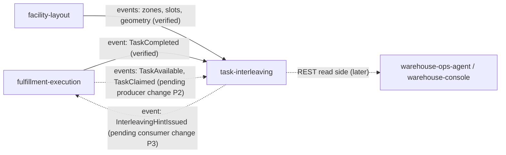

# Integration

How `task-interleaving` fits with the rest of the fleet, with the **status of every
edge**. Two words are used strictly:

- **Designed**: fixed by an ADR and the contracts in `apis/`, no runtime code on
  `develop`.
- **Implemented**: code on `develop` that does the job. Today that is only the
  domain, the CloudEvents helper and the acks=all writer constructor; **no edge
  below is implemented at runtime**, because the service (REST server, consumers,
  outbox relay) lives on an unmerged branch.

The producers' contracts were re-read on `origin/develop` of `fulfillment-execution`
and `facility-layout` on 2026-10-17 while writing this page; the findings are in
the *Status* column.

## Edge map

Source: `docs/adr/0001-task-interleaving-bounded-context.md` (context map),
`docs/adr/0003-local-copies-and-consumed-contracts.md`, `apis/asyncapi.yaml`.
Dotted edges are not built on either side.

## Upstream (task-interleaving consumes)

| Producer | Protocol | Topic | Contract (full `type`) | Status |
| --- | --- | --- | --- | --- |
| fulfillment-execution | Kafka, CloudEvents 1.0 | `warehouse.fulfillment.events` | `com.warehouse.wes.fulfillment-execution.task.TaskCompleted`: reads `task_id`, `station_id` | Producer side **verified**: on `fulfillment-execution` `origin/develop` the integration contract carries `TaskCompleted`. Consumer designed. |
| fulfillment-execution | Kafka, CloudEvents 1.0 | `warehouse.fulfillment.events` | `...task.TaskAvailable`: `task_id, task_type, site_id, from_location, to_location, required_capabilities[], cpt?, priority_band, available_at` | **Pending producer change P2.** Not in `fulfillment-execution`'s `apis/asyncapi.yaml` on `origin/develop` (grep found no `TaskAvailable`). Consumer designed to ship first. |
| fulfillment-execution | Kafka, CloudEvents 1.0 | `warehouse.fulfillment.events` | `...task.TaskClaimed`: `task_id, task_type, station_id, claimed_at` | **Pending producer change P2.** On `origin/develop` the producer publishes `TaskClaimed` only as an analytics occurrence (`AnalyticsTaskClaimed`, `urn:warehouse:fulfillment-execution:analytics:TaskClaimed:v1`) and without `claimed_at`. |
| facility-layout | Kafka, CloudEvents 1.0 | `warehouse.facility.events` | `com.warehouse.wms.facility-layout.zone.ZoneRegistered` (`zoneId, siteCode`) | **Verified** in `facility-layout`'s `apis/asyncapi.yaml` on `origin/develop`. Consumer designed. |
| facility-layout | same | same | `...locationslot.LocationSlotRegistered` (`locationCode, zoneId`) | **Verified**, consumer designed. |
| facility-layout | same | same | `...locationslot.LocationSlotDecommissioned` (`locationCode`) | **Verified**, consumer designed. |
| facility-layout | same | same | `...locationslot.LocationGeometryUpdated` (`locationCode, xM, yM, zM`) | **Verified**, consumer designed. |

Rules for every consumed message (ADR 0003, ADR 0004, all designed):

- Dispatch on the **full** `type`; every other type on those topics is ignored.
- A message that is not a valid CloudEvent is logged at WARN and committed past,
  never retried forever. The decoder that implements the rejection is on `develop`:
  `cloudevents.Decode` wraps `ErrNotCloudEvent` for anything that is not a valid
  CloudEvents 1.0 event, including the retired flat envelope.
- The CloudEvents `id` claim and the effect commit in one database transaction; the
  Kafka offset is committed afterwards, under a stable consumer group read from
  `FULFILLMENT_CONSUMER_GROUP` and `LAYOUT_CONSUMER_GROUP`.
- Each concern has a mode switch, `FULFILLMENT_MODE` and `LAYOUT_MODE`, `kafka` or
  `permissive`; the default is `permissive` (no consumer, the copy is whatever is in
  the database). Mode `kafka` with the group variable unset is a boot error.
- A task event for a task the copy never saw is counted and skipped, never
  dead-lettered, because with no row there is no position to record.
- A location with no geometry has an **unknown** distance: it is never a candidate
  and, as an origin, yields no hint.

## Downstream (task-interleaving publishes)

| Consumer | Protocol | Topic | Contract | Status |
| --- | --- | --- | --- | --- |
| fulfillment-execution | Kafka, CloudEvents 1.0 | `warehouse.task-interleaving.events` | `com.warehouse.wes.task-interleaving.stationtrip.InterleavingHintIssued` | Contract written (`apis/asyncapi.yaml`, ADR 0004). **Pending consumer change P3** in fulfillment-execution (no reference to task-interleaving or `InterleavingHint` in its code on `origin/develop`). Nothing on the floor changes until P3 exists. |
| the service's own analytics read side (later phase) | Kafka, CloudEvents 1.0 | `warehouse.task-interleaving.analytics` | `InterleavingHintIssued`, `InterleavingHintConsumed`, `InterleavingHintExpired`, `InterleavingPolicyDeclared` | Contract written. No consumer exists or is planned beyond ADR 0004's "a later phase". |
| warehouse-ops-agent, warehouse-console | REST (Open Host Service) | `apis/openapi.yaml` | policy, hints, stations, recommendations | **Later waves**; REST contract written, no server. |

Publication is through a transactional outbox: the aggregate row and its
already-encoded events are written in one transaction and a relay drains them to
Kafka, at least once, repeating the stored CloudEvents `id` on a retry. Both topic
rows of an occurrence are written in the same transaction. Designed; the writer
constructor `kafka.NewWriter(brokers)` (acks=all, hash balancer, no topic) is the
only piece of it on `develop`.

How fulfillment-execution is meant to use the hint (ADR 0001, ADR 0004; designed on
the consumer side, owned by that context): only as a tie-break **inside one priority
band**, never across a CPT or priority boundary; ignored once `expires_at` has
passed; **fail-open** when the hint is absent, expired or unknown. `priority_band`
is carried by this context and never interpreted.

## Absent edges (on purpose)

- **No REST and no MCP call to any sibling context, in either direction.** This
  context has no outbound HTTP client and no MCP client (ADR 0001); the hot claim
  path of fulfillment-execution never calls it. REST here is advisory reads for
  operators, the console and agents.
- **No edge** to `wes-work-planning`, `process-path-management`, `order-management`,
  `inventory-storage` or `labor-performance`.
- **No edge to `pick-face-replenishment`.** `REPLENISH` tasks reach this context
  only as ordinary `TaskAvailable` occurrences, like any other task type.
- **No per-worker data.** Hints are per station; the associate is not an input.
- No `cmd/mcp` and no MCP tool: nothing in the contracts names one.

## Failure behaviour (designed)

| Situation | Behaviour |
| --- | --- |
| Pool copy stale or empty | Hints are stale or absent, never wrong assignments: a hint is advisory and expires. Until producer change P2 lands the pool stays empty in a real cluster and no hint is issued; this is deliberate (consumer-first). |
| Site has no policy | Inert: no hint, `GET /sites/{siteId}/policy` is `404 policy-not-found`, a simulation is `422 policy-not-declared`. |
| Candidate task claimed elsewhere | The hint loses the tie-break in fulfillment-execution, which re-checks the claim. |
| Completion leaves no candidate | No hint is issued and an older Active hint is **not** retracted: it expires at its TTL (ADR 0002). |
| Origin without geometry | `recommend.ErrOriginUnknown`: no hint (implemented in the domain); REST `422 origin-unknown` (contract). |
| Replay | The copies are plain tables fed by a stable consumer group and can be rebuilt by replaying their topics (ADR 0003). |

## Live-data findings still owed

ADR 0003 asks that before the first live hint someone answers, from rows of the
service's own database: do the pool's `site_id` values equal facility-layout's
`siteCode` values; what share of pool task locations has a geometry point; is the
geometry frame the same for every location of a site. None can be answered on
`develop`.
