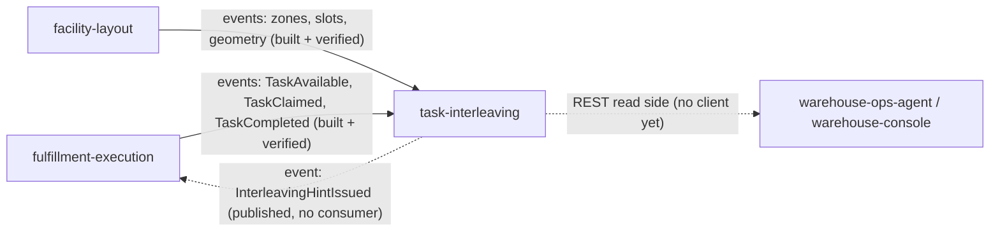

# Integration

How `task-interleaving` fits with the rest of the fleet, with the **status of
every edge**. Three words are used strictly:

- **Built**: code on this repo's `origin/develop` that does the job.
- **Verified**: the other side was read on its own `origin/develop`
  (`fulfillment-execution` at `7f113ed`, `facility-layout` at `4518c60`,
  `warehouse-infra` at `61f9e7a`, fetched 2026-10-17) and matches.
- **Absent**: no code on either side.

Both consumers are built and verified against their producers, but they are
**opt-in**: with `FULFILLMENT_MODE` / `LAYOUT_MODE` at their default
(`permissive`) nothing is consumed. `warehouse-infra` has no entry for this
service, so nothing starts the consumers in the shared cluster yet.

## Edge map

Source: `internal/adapters/inbound/kafka/fulfillment_consumer.go`,
`internal/adapters/inbound/kafka/layout_consumer.go`,
`internal/adapters/outbound/events/encoder.go`, `apis/asyncapi.yaml`, and the
producers' `apis/asyncapi.yaml` on their `origin/develop`. Solid edges have code
on both sides. Dotted edges have code on one side only.

## Upstream (task-interleaving consumes)

| Producer | Protocol | Topic | Contract (full `type`) | Status |
| --- | --- | --- | --- | --- |
| fulfillment-execution | Kafka, CloudEvents 1.0 | `warehouse.fulfillment.events` | `com.warehouse.wes.fulfillment-execution.task.TaskCompleted`: reads `task_id`, `station_id` | **Built + verified.** Present in the producer's `apis/asyncapi.yaml`; `station_id` is a required field of its payload. |
| fulfillment-execution | same | same | `...task.TaskAvailable`: reads `task_id, task_type, site_id, from_location, to_location, required_capabilities[], priority_band` (ignores `cpt`, `available_at`) | **Built + verified.** The producer publishes it since its ADR 0049 (commit `257a567`). **Only RELOCATE tasks are announced today**: the producer's AsyncAPI says a PICK, PACK, SLAM or REBIN task "has no location in this service" and is not announced (`apis/asyncapi.yaml` of fulfillment-execution, TaskAvailable description). |
| fulfillment-execution | same | same | `...task.TaskClaimed`: reads `task_id, task_type, station_id, claimed_at` | **Built + verified.** Published on the integration topic for every task type, with `claimed_at`. (The analytics-topic `TaskClaimed` is a separate, older row.) |
| facility-layout | Kafka, CloudEvents 1.0 | `warehouse.facility.events` | `com.warehouse.wms.facility-layout.zone.ZoneRegistered` (`zoneId`, `siteCode`, `zoneCode`) | **Built + verified** in the producer's `apis/asyncapi.yaml`. |
| facility-layout | same | same | `...locationslot.LocationSlotRegistered` (`locationCode`, `zoneId`) | **Built + verified.** |
| facility-layout | same | same | `...locationslot.LocationSlotDecommissioned` (`locationCode`) | **Built + verified.** |
| facility-layout | same | same | `...locationslot.LocationGeometryUpdated` (`locationCode`, `xM`, `yM`, `zM`) | **Built + verified.** The producer's AsyncAPI notes "No consumer wired today" for this message; this service is that consumer, once enabled. |

Consequence of the RELOCATE-only announcement: in a live cluster the open-task
pool, and therefore every candidate list, contains **RELOCATE tasks only**, and a
station's position is only recorded when it completes an announced (RELOCATE)
task, because the position is read from the pool copy's `to_location`. A
completion of any other task type is recorded as completed and ignored (outcome
`ignored`). The policy's other eligible task types have no effect until the
producer announces more types.

### How every consumed message is handled

(`internal/adapters/inbound/kafka`, `internal/application/usecases/intake.go`)

- Dispatch on the **full** `type`; every other type on those topics is ignored
  and its offset committed.
- A message that is not a valid CloudEvents 1.0 event (including the retired flat
  envelope) is logged at WARN and committed past; it is not dead-lettered.
- The claim of the CloudEvents `id` (table `processed_events`, consumer names
  `task-interleaving-fulfillment` and `task-interleaving-layout`) and the effect
  commit in **one** database transaction; the Kafka offset is committed
  afterwards (at least once). A replayed id has outcome `duplicate`.
- Outcomes logged as `event processed`: `applied`, `duplicate`, `stale` (older
  than what the copy holds, or a task already completed), `ignored` (not enough
  local data to act).
- A transient failure is retried with capped backoff (200 ms to 5 s), 5 attempts,
  then the message is published to `<topic>.dlq`
  (`warehouse.fulfillment.events.dlq`, `warehouse.facility.events.dlq`) with
  `x-dlq-*` headers. A payload that can never be applied (malformed `data`, a
  missing `task_id`, `site_id` or `from_location` on `TaskAvailable`, a missing
  `xM`/`yM`/`zM` or a non-finite coordinate on `LocationGeometryUpdated`) goes
  to the DLQ at once. Shutdown never dead-letters.
- Group ids come from `FULFILLMENT_CONSUMER_GROUP` and `LAYOUT_CONSUMER_GROUP`
  (no default). A group without a committed offset starts at the first offset.
- Mode `kafka` with the group variable or `KAFKA_BROKERS` missing is a boot
  error.
- A location with no geometry has an **unknown** distance: it is never a
  candidate and, as an origin, yields no hint.

## Downstream (task-interleaving publishes)

| Consumer | Protocol | Topic | Contract | Status |
| --- | --- | --- | --- | --- |
| fulfillment-execution (intended) | Kafka, CloudEvents 1.0 | `warehouse.task-interleaving.events` | `com.warehouse.wes.task-interleaving.stationtrip.InterleavingHintIssued` | **Published, not consumed.** This service writes it (outbox + relay, key = station id). fulfillment-execution's `origin/develop` has no code that reads the topic or the type; its ADR 0049 lists "consuming `InterleavingHintIssued`" as out of scope. Nothing on the floor changes until that consumer exists. |
| analytics read side | Kafka, CloudEvents 1.0 | `warehouse.task-interleaving.analytics` | `InterleavingHintIssued`, `InterleavingHintConsumed`, `InterleavingHintExpired` (key = station id), `InterleavingPolicyDeclared` (key = site id) | **Published, no consumer** anywhere; none is planned beyond ADR 0004's "a later phase". |
| operators, warehouse-console, warehouse-ops-agent | REST (Open Host Service) | `apis/openapi.yaml` | policy, hints, stations, recommendations | **Built** (the API), no known client. Not in `warehouse-infra`'s Kong routes. |

Publication is through the transactional outbox: the aggregate row and its
already-encoded events are written in one transaction, and the relay
(Postgres mode with `KAFKA_BROKERS`) drains them to Kafka at least once,
repeating the stored CloudEvents `id` on a retry, capped by `OUTBOX_MAX_ATTEMPTS`.
`InterleavingHintIssued` is written to both topics with the same `id`; the
other three types go to the analytics topic only. In-memory mode has no outbox,
so nothing is published. Details: [Runbook](/docs/operations/runbook#outbox-relay).

How fulfillment-execution is meant to use the hint (ADR 0001, ADR 0004; owned by
that context, not built): only as a tie-break **inside one priority band**,
never across a CPT or priority boundary; ignored once `expires_at` has passed;
**fail-open** when the hint is absent, expired or unknown. `priority_band` is
carried by this context and never interpreted.

## Infrastructure wiring

`warehouse-infra` (`origin/develop`) contains no reference to `task-interleaving`:
no Terraform service entry, no Kong route under `/api/task-interleaving`, no
ArgoCD application, no values file and no dashboard. This repo has no Helm chart
or `Dockerfile` either. So the service is **built but not deployed**: the Kafka
edges above are wired in code and unused in the cluster.

## Absent edges (on purpose)

- **No REST and no MCP call to any sibling context, in either direction.** This
  context has no outbound HTTP client and no MCP client (ADR 0001); the hot claim
  path of fulfillment-execution never calls it. REST here is advisory reads for
  operators, the console and agents.
- **No edge** to `wes-work-planning`, `process-path-management`, `order-management`,
  `inventory-storage` or `labor-performance`.
- **No edge to `pick-face-replenishment`.** `REPLENISH` tasks reach this context
  only as ordinary `TaskAvailable` occurrences, like any other task type.
- **No per-worker data.** Hints are per station; the associate is not an input.
- No `cmd/mcp` and no MCP tool: nothing in the contracts names one.

## Failure behaviour

| Situation | Behaviour |
| --- | --- |
| Postgres down at boot | Retried for about 15 s, then the process exits 1 and the orchestrator restarts it. |
| Postgres down at runtime | REST answers 500 `internal-error` (statement timeout 5 s); consumers fail transiently, retry, and after 5 attempts dead-letter the message. `/readyz` stays 200 (it checks nothing). |
| Kafka down | The REST API is unaffected. The relay logs `outbox relay pass failed` and retries every interval; rows stay in `outbox_events`. Consumers block on the reader and resume. Kafka connections are lazy, so boot never waits for the broker. |
| Pool copy stale or empty | Hints are stale or absent, never wrong assignments: a hint is advisory and expires. |
| Site has no policy | Inert: no hint, `GET /sites/{siteId}/policy` is `404 policy-not-found`, a simulation is `422 policy-not-declared`. |
| Candidate task claimed elsewhere | `TaskClaimed` removes it from the pool copy before the next ranking; an already issued hint keeps listing it and loses the tie-break in fulfillment-execution, which re-checks the claim. |
| Completion leaves no candidate | No hint is issued and an older Active hint is **not** retracted: it expires at its TTL (ADR 0002). |
| Origin without geometry | `recommend.ErrOriginUnknown`: no hint on the consumer path, `422 origin-unknown` over REST. |
| Duplicate or replayed event | Outcome `duplicate`, no effect. |
| Poison message | Dead-lettered, the partition moves on. |
| Replay | The copies are plain tables fed by a stable consumer group and can be rebuilt by replaying their topics (ADR 0003), subject to the `processed_events` claims described in the [Runbook](/docs/operations/runbook#routine-procedures). |

## Live-data findings still owed

ADR 0003 asks that before the first live hint someone answers, from rows of the
service's own database: do the pool's `site_id` values equal facility-layout's
`siteCode` values; what share of pool task locations has a geometry point; is the
geometry frame the same for every location of a site. None can be answered from
the repository, and `warehouse-infra` has no entry that would produce such rows.
