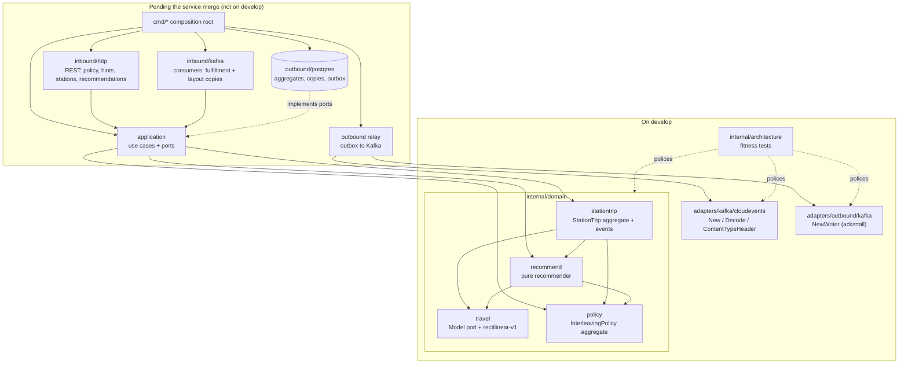

# Architecture

`task-interleaving` follows the fleet's hexagonal (ports and adapters) layout:
dependencies point inward, the domain imports nothing from the rest of the
module, and only `cmd/` wires the layers together.

:::caution Built vs designed
`develop` holds the **domain** (`internal/domain`), two **adapter building
blocks** and the **fitness tests**. It has no `internal/application`, no HTTP or
Kafka-consumer adapters, no Postgres adapter, no outbox relay and no `cmd/`
binary. Those belong to the service branch that has not been merged. The diagrams
below mark every box as *on develop* or *pending*.
:::

## Layout

| Layer | Path | On develop | Role |
| --- | --- | --- | --- |
| Domain | `internal/domain/policy` | yes | `Policy` aggregate (`InterleavingPolicy`): per-site settings, versioned, immutable. `SiteID`, `TaskType`, `Settings`. |
| Domain | `internal/domain/travel` | yes | The travel-distance **port** `travel.Model` and its v1 implementation `Rectilinear` (`rectilinear-v1`). `Point`, `Place`. |
| Domain | `internal/domain/recommend` | yes | The pure recommender `Recommend(Input)`; `OpenTask`, `Candidate`; `RectilinearFor(policy)`. |
| Domain | `internal/domain/stationtrip` | yes | `StationTrip` aggregate: position, hint lifecycle, domain events `HintIssued`, `HintConsumed`, `HintExpired`. |
| Application | `internal/application` (use cases) and `internal/application/ports` | **no** | Use cases and the OUT ports adapters implement. Pending the service merge. |
| Inbound adapters | `internal/adapters/inbound/{http,kafka,mcp}` | **no** | REST handlers, Kafka consumers. Pending. |
| Outbound adapters | `internal/adapters/outbound/kafka` | partly | Only `NewWriter(brokers)` exists: a synchronous, `RequiredAcks: RequireAll`, `Hash`-balanced kafka-go writer with no `Topic` (the relay sets `Message.Topic` per message). The Postgres repositories and the outbox relay are pending. |
| Kafka envelope | `internal/adapters/kafka/cloudevents` | yes | The only place a CloudEvents 1.0 envelope is built or decoded: `New(Spec)`, `Decode`, `ContentTypeHeader`, `Type`, `DataSchema`. Constants `Repo = "task-interleaving"`, `Subdomain = "wes"`, `Context = "task-interleaving"`, `Source = "/warehouse/task-interleaving"`. |
| Composition root | `cmd/` | **no** | Nothing under `cmd/` exists. |
| Fitness tests | `internal/architecture` | yes | arch-go and source-scanning tests; see below. |

### Ports as declared in the domain

The domain declares exactly one port today:

```go
// internal/domain/travel/travel.go
type Model interface {
    Name() string
    Distance(from, to Place) (float64, bool)
}
```

`Distance` returns metres and whether the distance is known; a `Place` with no
point, or with a non-finite coordinate, is *unknown*, never 0. The recommender
takes the model as input (`Input.Model`, required: `ErrNoModel` otherwise) and
`recommend.RectilinearFor(policy)` builds the v1 model from the policy's
`VerticalWeight`. A later model (aisle and cross-aisle routing, a candidate named
in [ADR 0002](/docs/adr/0002-stationtrip-and-policy-aggregates)) implements the
same interface under its own ADR.

The application-level OUT ports (repositories, outbox, clock, id generator) are
not declared yet: `internal/application/ports` does not exist on `develop`.

## Component diagram



Source: `internal/domain/*/*.go` import lists (`stationtrip` imports `policy`,
`recommend`, `travel`; `recommend` imports `policy`, `travel`; `policy` and
`travel` import only the standard library),
`internal/adapters/kafka/cloudevents/cloudevents.go`,
`internal/adapters/outbound/kafka/writer.go`,
`internal/architecture/architecture_test.go`. The *pending* box and its arrows are
the layout fixed by [ADR 0001](/docs/adr/0001-task-interleaving-bounded-context)
and [ADR 0004](/docs/adr/0004-cloudevents-envelope-and-type-catalogue); no code
backs them on `develop`.

## Binaries and ports

There is no `cmd/` on `develop`, hence no binary, no listening port and no probe.
The design (ADR 0001, `apis/openapi.yaml`) is **one deployable**: an API serving
REST (the OpenAPI spec names `http://localhost:8080` locally and Kong's
`/api/task-interleaving` in the kind cluster), the Kafka consumers and the outbox
relay. How many binaries the service branch ends up with is not decided by
anything on `develop`.

## Data stores

None exist in code on `develop`. The design calls for one Postgres database
holding the two aggregates, the event-fed copies (open-task pool, claims, location
geometry) and the transactional outbox
([ADR 0003](/docs/adr/0003-local-copies-and-consumed-contracts),
[ADR 0004](/docs/adr/0004-cloudevents-envelope-and-type-catalogue)), and the fleet's
single Kafka broker for the topics `warehouse.task-interleaving.events` and
`warehouse.task-interleaving.analytics`. The schema is not written; do not infer
table names from this page.

## Rules enforced by `internal/architecture`

The tests run on every PR (`arch-test` job, `make arch-test`). Rules that apply
to the code that exists:

| Test | Rule |
| --- | --- |
| `TestHexagonalArchitecture` (6 subtests) | `**.internal.domain.**` depends only on domain; `**.internal.application.**` only on domain and application; inbound adapters do not depend on outbound adapters and vice versa; nothing under `internal/` imports `cmd`; `internal/application/ports` holds only interfaces. Rules about packages that do not exist yet pass vacuously. |
| `TestMCPAdapterDependencyRule` | An MCP adapter, if added, depends only on application and domain, and nothing depends on it. |
| `TestNoAuthMiddlewareReintroduced` | No `"Bearer "`, `golang-jwt/jwt`, `dgrijalva/jwt-go` or `lestrrat-go/jwx` in non-comment source under `internal/adapters/inbound`: REST and MCP are unauthenticated fleet-wide. |
| `TestKafkaConsumerGroupNeverHardcodedInline` | No `GroupID: "literal"`; the group id comes from a named symbol (the design reads it from `FULFILLMENT_CONSUMER_GROUP` / `LAYOUT_CONSUMER_GROUP`). |
| `TestNoEventEnvelopeToggleOrFlatEnvelope`, `TestCloudEventsOnly` | CloudEvents 1.0 is the only envelope: no `EVENT_ENVELOPE_MODE`, no flat `event_id` + `event_type` struct, and a module that uses kafka-go must import the CloudEvents SDK. |
| `TestKafkaWritersSetRequiredAcks` | Every kafka-go `Writer{...}` literal sets `RequiredAcks` (the library default is fire-and-forget). |
| `TestKafkaWriterTopicNotSetTwice` | If a package sets `Message.Topic`, no `Writer` in it sets `Topic` (kafka-go refuses such writes). |
| `TestReplayConsumersSetCommitInterval` | A reader with a process-unique group id must set `CommitInterval`. |
| `TestEventCatalogueMatchesContract` | Every full CloudEvents type that `apis/asyncapi.yaml` declares for this service appears in the CloudEvents ADR (`docs/adr/0004-cloudevents-envelope-and-type-catalogue.md`). |
| `TestKafkaIntegrationTestsUseTestcontainers`, `TestPostgresIntegrationTestsUseTestcontainers` | `*_integration_test.go` files boot their own broker or database; no `KAFKA_BROKERS` / `DATABASE_URL` gate, no `localhost:9092`. |

Rules that skip today because the code they police is absent:
`TestDeadLetterCallsGuardCancellation` (no `internal/adapters/inbound/kafka`),
`TestMCPOptionalToolInputsCarryOmitempty` (no MCP adapter) and
`TestOutboxRelaysPassAttemptCap` (no outbox relay). They start biting when the
service lands. Details and run commands are on [Testing](/docs/development/testing).
