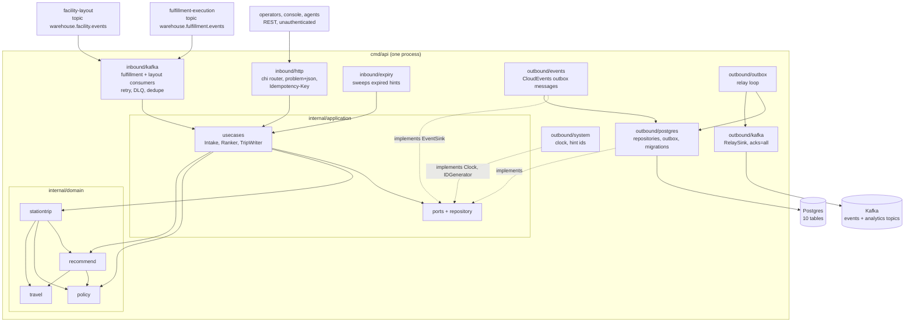

# Architecture

`task-interleaving` follows the fleet's hexagonal (ports and adapters) layout:
dependencies point inward, the domain imports nothing from the rest of the
module, and only `cmd/` wires the layers together. Everything on this page is on
`develop`; the one thing that is not (an MCP adapter) is called out.

## Layout

| Layer | Path | Role |
| --- | --- | --- |
| Domain | `internal/domain/policy` | `Policy` aggregate (`InterleavingPolicy`): per-site settings, versioned, immutable. `SiteID`, `TaskType`, `Settings`. |
| Domain | `internal/domain/travel` | The travel-distance **port** `travel.Model` and its v1 implementation `Rectilinear` (`rectilinear-v1`). `Point`, `Place`. |
| Domain | `internal/domain/recommend` | The pure recommender `Recommend(Input)`; `OpenTask`, `Candidate`; `RectilinearFor(policy)`. |
| Domain | `internal/domain/stationtrip` | `StationTrip` aggregate: position, hint lifecycle, domain events `HintIssued`, `HintConsumed`, `HintExpired`. |
| Application | `internal/application/usecases` | The use cases (see [Use cases](/docs/ddd/use-cases)), `Intake` (claim-and-apply skeleton of the consumers), `Ranker` (the recommender over the local copies), `TripWriter` (save a trip and hand its events to the outbox). |
| Application | `internal/application/ports`, `repository`, `outbox` | The OUT ports (`PolicyRepo`, `StationTripRepo`, `TaskPool`, `LocationBook`, `EventSink`, `ProcessedEvents`, `IdempotencyStore`, `UnitOfWork`, `Clock`, `IDGenerator`), the records they exchange and the already-encoded outbox `Message`. `ports` holds only interfaces. |
| Inbound adapter | `internal/adapters/inbound/http` | chi router for `apis/openapi.yaml`: handlers, RFC 7807 problem mapping (`errors.go`), the `Idempotency-Key` middleware, `/healthz` and `/readyz`. No auth middleware. |
| Inbound adapter | `internal/adapters/inbound/kafka` | The fulfillment and layout consumers: CloudEvents decode, dispatch on the full `type`, retry with backoff, dead-letter topic. Decode only; every effect is a use case. |
| Inbound adapter | `internal/adapters/inbound/expiry` | Timer-driven worker that calls `ExpireHints` every interval. |
| Outbound adapter | `internal/adapters/outbound/postgres` | pgxpool repositories, unit of work (`pgtx`), outbox repository, embedded migrations (`migrate.go`, top-level `migrations/`). |
| Outbound adapter | `internal/adapters/outbound/memory` | In-memory implementation of every port: a **test double** for the unit and BDD suites. The shipped binary never imports it (`TestRuntimeBinaryHasNoInMemoryAdapters`). |
| Outbound adapter | `internal/adapters/outbound/system` | The production `Clock` and hint-id generator, the two adapters that need no infrastructure. |
| Outbound adapter | `internal/adapters/outbound/events` | Maps domain facts to CloudEvents outbox messages (`Sink`, `encoder.go`). |
| Outbound adapter | `internal/adapters/outbound/outbox` | The relay loop that drains the outbox to a sink. |
| Outbound adapter | `internal/adapters/outbound/kafka` | `NewWriter` (acks=all, hash balancer, no fixed topic), `RelaySink` and `BrokerCheck` (the Kafka half of `/readyz`). |
| Kafka envelope | `internal/adapters/kafka/cloudevents` | The only place a CloudEvents 1.0 envelope is built or decoded: `New(Spec)`, `Decode`, `ContentTypeHeader`, `Type`, `DataSchema`. Constants `Repo = "task-interleaving"`, `Subdomain = "wes"`, `Context = "task-interleaving"`, `Source = "/warehouse/task-interleaving"`. |
| Support | `internal/bootretry` | Exponential-backoff retry for the first outbound dials at boot. |
| Composition root | `cmd/api` | `main.go` (run, shutdown order), `config.go` (env parsing, `loadBootConfig`), `adapters.go` (the Postgres adapters), `consumers.go`, `relay.go` (workers), `topics.go` (what `/readyz` requires). |
| Test support | `internal/testing/{kafkatest,pgtest,repocontract}` | Shared testcontainers helpers (the test broker has topic auto-creation off) and the repository contract suite run against both the memory and Postgres adapters. |
| Fitness tests | `internal/architecture` | arch-go and source-scanning tests; see below. |

The domain declares one port, the distance model:

```go
// internal/domain/travel/travel.go
type Model interface {
    Name() string
    Distance(from, to Place) (float64, bool)
}
```

`Distance` returns metres and whether the distance is known; a `Place` with no
point, or with a non-finite coordinate, is *unknown*, never 0. The recommender
takes the model as input (`Input.Model`, required: `ErrNoModel` otherwise) and
`recommend.RectilinearFor(policy)` builds the v1 model from the policy's
`VerticalWeight`. A later model (aisle and cross-aisle routing, a candidate named
in [ADR 0002](/docs/adr/0002-stationtrip-and-policy-aggregates)) implements the
same interface under its own ADR.

## Binaries and ports

| Binary | Role | Port | Probes |
| --- | --- | --- | --- |
| `cmd/api` | The only binary. REST API, hint-expiry worker, outbox relay and the two Kafka consumers run in one process, all always on, on real Postgres and Kafka ([ADR 0006](/docs/adr/0006-postgres-and-kafka-are-the-only-runtime)). | `HTTP_ADDR`, default `:8080` | `GET /healthz` (liveness), `GET /readyz` (drain gate, Postgres ping, Kafka topics have a leader) |

There is no `cmd/mcp`: this context has no MCP server. How the process boots,
what it starts and in which order it stops is in the
[Runbook](/docs/operations/runbook); every variable is in
[Configuration](/docs/operations/configuration).

## Container and component diagram



Source: `cmd/api/main.go`, `cmd/api/adapters.go`, `cmd/api/consumers.go`,
`cmd/api/relay.go` (wiring and workers), `cmd/api/topics.go`,
`internal/application/ports/ports.go`
(the OUT ports), `internal/domain/*/*.go` import lists (`stationtrip` imports
`policy`, `recommend`, `travel`; `recommend` imports `policy`, `travel`),
`internal/adapters/outbound/events/sink.go` and
`internal/architecture/architecture_test.go`. The in-memory adapters are not in
the diagram because the binary does not wire them.

## Data stores

One Postgres database, created by the single embedded migration
(`migrations/0001_interleaving_schema.up.sql`, [ADR 0005](/docs/adr/0005-persistence-and-evaluation-semantics)):

| Table | Holds |
| --- | --- |
| `interleaving_policies` | One row per site, `version` guards every update. |
| `station_trips`, `hints`, `candidates` | The StationTrip aggregate, the hint history (one Active hint per station, enforced by a partial unique index) and each hint's ranked candidates. |
| `task_pool` | Local copy of the open-task pool, state `AVAILABLE`, `CLAIMED` or `COMPLETED`. |
| `zones`, `locations` | Local copy of the facility layout, including geometry and the irreversible `decommissioned` flag. |
| `processed_events` | `(consumer, event_id)` claims that make the consumers idempotent. |
| `outbox_events` | The transactional outbox; one row per message and destination topic. |
| `idempotency_keys` | Stored answers of `POST /recommendations`. |

Postgres is the only store: the service refuses to boot without `DATABASE_URL`
and nothing is served from process memory. Kafka is the fleet's single broker;
this service produces to `warehouse.task-interleaving.events` and
`warehouse.task-interleaving.analytics` and consumes
`warehouse.fulfillment.events` and `warehouse.facility.events`. It never creates
a topic: infrastructure owns them, and `/readyz` is 503 until all four have a
leader.

## Rules enforced by `internal/architecture`

The tests run on every PR (`arch-test` job, `make arch-test`):

| Test | Rule |
| --- | --- |
| `TestHexagonalArchitecture` (6 subtests) | `**.internal.domain.**` depends only on domain; `**.internal.application.**` only on domain and application; inbound adapters do not depend on outbound adapters and vice versa; nothing under `internal/` imports `cmd`; `internal/application/ports` holds only interfaces. |
| `TestMCPAdapterDependencyRule` | An MCP adapter, if added, depends only on application and domain, and nothing depends on it. |
| `TestNoAuthMiddlewareReintroduced` | No `"Bearer "`, `golang-jwt/jwt`, `dgrijalva/jwt-go` or `lestrrat-go/jwx` in non-comment source under `internal/adapters/inbound`: REST is unauthenticated fleet-wide. |
| `TestKafkaConsumerGroupNeverHardcodedInline` | No `GroupID: "literal"`; the group id comes from `FULFILLMENT_CONSUMER_GROUP` / `LAYOUT_CONSUMER_GROUP`. |
| `TestRuntimeBinaryHasNoInMemoryAdapters`, `TestRuntimeBinarySensorBites` | No non-test file under `cmd/**` imports `internal/adapters/outbound/memory`: the binary runs on Postgres and Kafka only (ADR 0006). The second test proves the detector flags plain, aliased, blank, dot and nested imports. |
| `TestNoEventEnvelopeToggleOrFlatEnvelope`, `TestCloudEventsOnly` | CloudEvents 1.0 is the only envelope: no `EVENT_ENVELOPE_MODE`, no flat `event_id` + `event_type` struct, and a module that uses kafka-go must import the CloudEvents SDK. |
| `TestKafkaWritersSetRequiredAcks` | Every kafka-go `Writer{...}` literal sets `RequiredAcks` (the library default is fire-and-forget). |
| `TestKafkaWriterTopicNotSetTwice` | If a package sets `Message.Topic`, no `Writer` in it sets `Topic` (kafka-go refuses such writes). |
| `TestReplayConsumersSetCommitInterval` | A reader with a process-unique group id must set `CommitInterval`. |
| `TestDeadLetterCallsGuardCancellation` | Every function under `internal/adapters/inbound/kafka` that sends to a dead-letter topic must check `ctx.Err()` or `context.Canceled` (or carry a `//dlq:deterministic <reason>` annotation), so a shutdown never dead-letters a message that was only mid-flight. |
| `TestOutboxRelaysPassAttemptCap` | Every `NewRelay` / `NewOutboxRelay` call passes a `WithMaxAttempts(...)` option; there is no skip path. |
| `TestEventCatalogueMatchesContract` | Every full CloudEvents type that `apis/asyncapi.yaml` declares for this service appears in the CloudEvents ADR (`docs/adr/0004-cloudevents-envelope-and-type-catalogue.md`). |
| `TestKafkaIntegrationTestsUseTestcontainers`, `TestPostgresIntegrationTestsUseTestcontainers` | `*_integration_test.go` files boot their own broker or database; no `KAFKA_BROKERS` / `DATABASE_URL` gate, no `localhost:9092`. |

`TestMCPOptionalToolInputsCarryOmitempty` skips (there is no MCP adapter); every
other sensor runs. Details and commands are on [Testing](/docs/development/testing).
